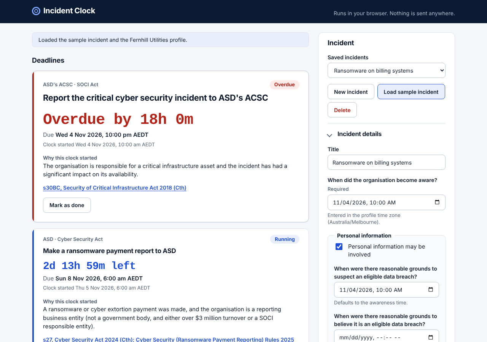

# Incident Clock

Incident Clock turns a cyber incident into every Australian regulatory reporting deadline it triggers, with live countdowns and the section of law behind each one. It runs entirely in the browser; no incident data leaves the machine.

Live site: https://thisulzen.github.io/incident-clock/



## Why

One cyber incident can start several legal clocks at once, and they are measured differently: 12 hours, 72 hours, 30 days, 10 business days, or "as soon as practicable". The privacy team watches one, the security team another, the risk team a third, and nobody sees them side by side. This puts them on one board with the start event, the due time in the organisation's own time zone and the section of law for each.

## What it covers

| Regime | Trigger | Deadline | Citation |
| --- | --- | --- | --- |
| Privacy Act | APP entity, personal information involved | 30 days to finish the eligible data breach assessment | s26WH, Privacy Act 1988 (Cth) |
| Privacy Act | Reasonable grounds to believe it is an eligible data breach | As soon as practicable | ss26WK and 26WL, Privacy Act 1988 (Cth) |
| SOCI Act | Responsible entity, significant impact (critical incident) | 12 hours; written record 84 hours after the oral report | s30BC, Security of Critical Infrastructure Act 2018 (Cth) |
| SOCI Act | Responsible entity, relevant impact | 72 hours; written record 48 hours after the oral report | s30BD, Security of Critical Infrastructure Act 2018 (Cth) |
| Cyber Security Act | Ransomware payment, not a government body, over $3 million turnover or SOCI responsible | 72 hours from payment | s27, Cyber Security Act 2024 (Cth); Cyber Security (Ransomware Payment Reporting) Rules 2025 |
| APRA | Material information security incident | 72 hours | para 35, APRA Prudential Standard CPS 234 Information Security |
| APRA | Material control weakness the entity cannot remediate in time | 10 business days | para 36, APRA Prudential Standard CPS 234 |
| APRA | Material operational risk incident | 72 hours (covered by the CPS 234 notice if it is the same event) | APRA Prudential Standard CPS 230 Operational Risk Management |
| APRA | Critical operation outside tolerance | 24 hours | APRA Prudential Standard CPS 230 |
| Victoria | Victorian public sector, information security incident | 30 days | Element E9.010, Victorian Protective Data Security Standards |

Each rule links to an official source. Rules were last reviewed on 5 November 2026.

## How deadlines are calculated

- **Hours** are elapsed time. A 72-hour clock is exactly 72 × 3,600,000 ms after the start, even across a daylight saving change. Only the local time shown shifts.
- **Calendar days** keep the same local wall-clock time in the organisation's time zone. Thirty days after 10:00 am AEDT can be 10:00 am AEST, which is not 720 hours later. The local time is read with `Intl.DateTimeFormat`, the date is moved, then the result is converted back to an instant by guessing with the start offset and correcting once with the offset at the result. If the target time does not exist (a spring-forward gap) it moves forward to the next valid time.
- **Business days** count Monday to Friday in the organisation's time zone and keep the local time. A weekend start counts from the following Monday.
- **As soon as practicable** has no due time. The card shows the time elapsed since the clock started.

Time zones available: Melbourne (default), Sydney, Brisbane, Adelaide, Darwin, Perth and Hobart. Date-times are typed as local times in the chosen zone and stored as UTC instants.

## Design

I made it browser-only on purpose: with no server, there is nowhere for incident data to go. It is kept in `localStorage`, falling back to memory if storage is blocked, and a test checks that nothing under `src/` uses `fetch`, `XMLHttpRequest`, `WebSocket` or `sendBeacon`. The site is plain HTML, CSS and ES modules with no build step and no dependencies, so it works from GitHub Pages or `python3 -m http.server`.

The rules live in `src/rules.js` as data. Each has a trigger, a start event, a duration, a plain-English reason, a citation and a source URL, so a reviewer can check a rule against the law without reading any UI code. The engine, `computeClocks(profile, incident, now)`, is a pure function that takes the time as an argument, which is what makes the time tests deterministic.

Trade-offs: public holidays are not excluded from business-day counts, and the rules are a fixed list rather than something users can edit.

## Running it locally

```
python3 -m http.server
```

Then open http://localhost:8000. Tests use Node's built-in runner (Node 22, no install step):

```
node --test
```

## What testing turned up

- My first business-day function treated a Saturday start as if it were already a weekday count, so Saturday plus one business day landed on Monday. The comment above it said Tuesday. The test I wrote for "a Saturday start counts from Monday" failed and I changed the code to roll a weekend start forward to Monday first.
- `node --test` runs every file under `test/`, including my shared helper module, so the helper shows up as a test with no assertions in it. I left it that way rather than add configuration.
- The ransomware reporting page I had written down did not match the real one. A search turned up the actual address, which ends in `ransomware-payment-and-cyber-extortion-payment-reporting`, and I used that. I could not load the other source pages from my build environment, so those links are unchecked.

## Limitations

- Public holidays are not excluded from business days, so the 10 business day CPS 234 clock can be earlier than the real deadline when a holiday falls inside it. The code has a note on where a state holiday table would go.
- Several rules (the CPS 230 notices in particular) are summarised from regulator guidance, not quoted from a single section, so their citations name the standard rather than a paragraph.
- The tool does not decide whether an incident is an eligible data breach, material, critical or relevant. You enter those judgements.
- Data is stored per browser. Clearing site data removes it, so use the JSON download to keep a copy.
- Only the seven Australian time zones listed are supported.

## Not legal advice

This is general information, not legal advice. Check obligations against the legislation and your own advice. Do not rely on it as the only record of what you must report.
